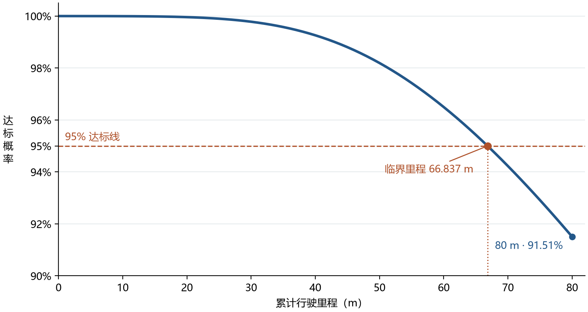
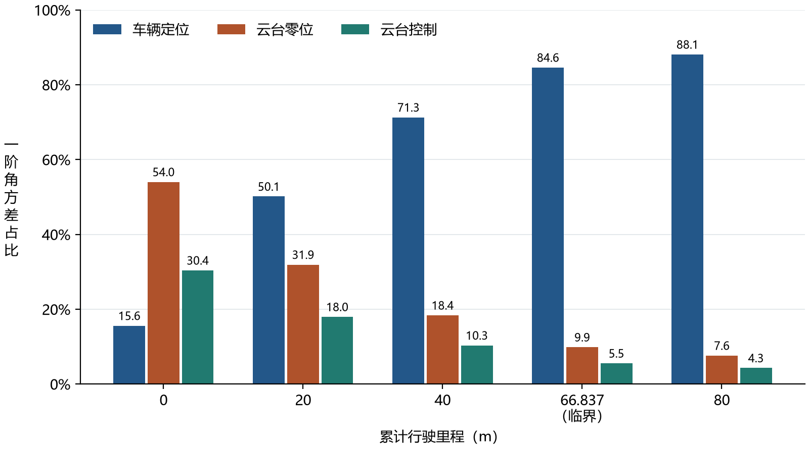

# 第三问　定位误差与指向误差对水平方位精度的影响

在题设的 40 m 水平距离下，若要求方位偏差落在 ±5° 内的概率至少为 95%，累计行驶距离的连续上限约为 **66.837258 m**，整米上限为 **66 m**。若行驶 80 m，单轴定位标准差须控制在约 **1.636745 m** 以内。

## 1　从位置估计到方位偏差

以车辆真实位置为原点，以指向目标水平投影的方向为第一坐标轴、逆时针转 90° 为第二轴。两轴上的定位误差分别记为 $U$ 和 $V$。题设中原坐标误差独立、同方差且服从正态分布，旋转后仍有 $U,V\overset{\mathrm{iid}}{\sim}N(0,\sigma^2)$，其中 $\sigma=0.3+0.02s$（m）。真实目标向量为 $(R,0)$，$R=40$ m。由于定位误差定义为估计位置减真实位置，从估计位置看目标的向量为 $(R-U,-V)$。目标高度不进入这个水平投影。

记 $c=\pi/180$，零位偏差与控制误差分别为 $\epsilon_0\sim N(0,(0.8c)^2)$ 和 $\epsilon_c\sim N(0,(0.6c)^2)$。两者与位置误差相互独立，故总云台误差 $G=\epsilon_0+\epsilon_c\sim N(0,c^2)$。以弧度计，方位偏差为

$$
\Theta=\operatorname{atan2}(-V,R-U),\qquad
\Delta\psi=\operatorname{wrap}(\Theta+G),\qquad
\operatorname{wrap}(x)=((x+\pi)\bmod 2\pi)-\pi .
$$

这里 $\Theta$ 是按估计位置计算的几何指令偏差，$\Delta\psi$ 则计入指令执行时的两项云台误差。例如车辆位置被高估到真实视线左侧，即 $V>0$ 且 $U<R$ 时，几何指令向右偏，$\Theta<0$，与误差符号约定一致。

## 2　达标概率与最大允许里程

令 $h=5c$，$\Phi$ 为标准正态分布函数。给定 $\Theta=\theta$ 时，落入容差的各个角度区间相隔 $2\pi$。对这些互斥区间求和，再对位置误差取期望，即得覆盖率

$$
K(\theta)=\sum_{k\in\mathbb Z}\left[
\Phi\!\left(\frac{h-\theta+2k\pi}{c}\right)
-\Phi\!\left(\frac{-h-\theta+2k\pi}{c}\right)\right],
\qquad p(\sigma)=\mathbb E[K(\Theta)] .
$$

为计算期望，把 $(R-U,-V)$ 的二维正态密度写成极坐标。角密度为

$$
f_\sigma(\theta)=\int_0^\infty
\frac{r}{2\pi\sigma^2}
\exp\!\left[-\frac{r^2-2Rr\cos\theta+R^2}{2\sigma^2}\right]\,dr .
$$

程序先解析积去半径 $r$，再对 $K(\theta)f_\sigma(\theta)$ 在 $[-\pi,\pi)$ 上作等距周期积分。计算 $K$ 时保留 $k=-1,0,1$；其余区间与云台误差均值至少相隔 535 个标准差。下表将积分结果与直接模拟比较。

| 累计距离（m） | 积分覆盖率 | 蒙特卡洛覆盖率 |
|---:|---:|---:|
| 0 | 99.9996% | 99.9998% |
| 66 | 95.1967% | 95.1813% |
| 66.837258（阈值近似） | 95.0000% | 94.9890% |
| 67 | 94.9614% | 94.9513% |
| 80 | 91.5068% | 91.5046% |

**图 3-1　达标概率随累计里程的变化。** 蓝线为非线性积分结果。橙色水平线表示 95% 的最低要求，交点对应的累计里程约为 66.837 m；从交点继续行驶至 80 m，达标概率降至 91.51%。

**距离阈值。** 非线性模型的连续距离上限约为 66.837258 m。若距离取整数米，最大满足值为 66 m。一阶误差传播给出约 66.922299 m，两种算法相差约 0.085 m。阈值处位置标准差与水平距离之比约为 0.041，与线性化所需的小扰动条件一致。

**为何取唯一阈值。** 用位置标准差归一化，在固定同一组标准正态样本后，相对位置向量可写成 (40/σ − X, −Y)。减小 σ 只会增大横轴分量，因此方位角的绝对值逐样本减小。独立云台误差的折返正态密度关于零对称，在 0 至 π 上随角度递减；固定位置角误差时，越接近零，落入对称容差区间的条件概率越高。故随 σ 增大，总覆盖率递减，可以用二分查找 95% 的交点。

## 3　行驶 80 m 的参数约束

记方程 $p(\sigma_\star)=0.95$ 的根为 $\sigma_\star$。由上述单调性，当且仅当下式成立，80 m 处满足精度要求。由于 $b\ge 0$，沿途较短里程也满足要求。

$$
a\ge0,\qquad b\ge0,\qquad a+80b\le\sigma_\star,\qquad
\sigma_\star\approx1.63674517\ \mathrm m .
$$

其中 $a$ 为起始单轴标准差（m），$b$ 为每行驶一米的标准差增量（m/m）。原参数给出 $0.3+80\times0.02=1.9$ m，覆盖率为 91.5068%。若保持 $a=0.3$ m，取 $b=0.0167$ m/m 时末端为 1.636 m，满足约束。若保持 $b=0.02$ m/m，则须将 $a$ 降至约 0.036745 m 或更低。

## 4　误差贡献与使用建议

在 $U=V=0$ 处线性化，得 $\Theta\approx -V/R$。沿视线误差 $U$ 的一阶导数为零，横向误差 $V$ 的一阶导数为 $-1/R$，因此两轴定位噪声合计贡献 $\sigma^2/R^2$。由独立性，总角方差的近似式为

$$
\tau^2(s)=\frac{\sigma^2(s)}{R^2}+(0.8c)^2+(0.6c)^2,\qquad
p_{\rm lin}(s)=2\Phi(h/\tau(s))-1.
$$

令 $\tau=h/\Phi^{-1}(0.975)$ 可复算上文的线性化里程。下表以各独立项的方差除以 $\tau^2$，比较它们对方位波动的相对贡献。

| 累计里程 | 车辆定位 | 云台零位 | 云台控制 |
|---|---:|---:|---:|
| 0 m | 15.59% | 54.02% | 30.39% |
| 临界里程 | 84.61% | 9.85% | 5.54% |
| 80 m | 88.10% | 7.61% | 4.28% |

**图 3-2　不同累计里程下三类误差对水平方位方差的贡献。** 每组柱按该里程的一阶总角方差归一化。起步时云台零位贡献最大；到 20 m，车辆定位已占 50.1%，到临界里程时升至 84.6%。云台两项的绝对方差在模型中保持恒定，其占比随定位方差增大而下降。

起步时，优先检查云台零位标定。接近临界里程时，应优先核查随里程增长的定位误差。若里程按整米记录，可采用 66 m 上限；若按厘米记录，可采用 66.83 m，向上舍入到 66.84 m 已使积分覆盖率降到 94.99935%。80 m 工况应按上节约束核验定位参数。现场使用前，可在已知方向的静态标定点分里程记录角差，检查零均值、独立性和标准差增长率是否与题设一致。

## 5　数值验证与复现

**复核。** 主方法将二维正态位置向量转换为极坐标，积掉径向分量，对方向角密度与云台容差概率之积作周期数值积分。角度网格从 4096 点加密到 8192 点，所得临界标准差在本次二分精度下相同。独立计算方法直接采样四个误差分量并折返角差，每个距离使用 100 万组样本，随机种子 20261120。各行复用同一组基础样本，行间结果相关。阈值处模拟覆盖率的 Wilson 95% 区间为 [94.9461%, 95.0316%]，包含积分值。此验证针对题设概率模型，未使用现场实测数据。

运行环境为 Python 与 NumPy 2.3.5。从第三问目录运行 `python 代码/measurement_run.py`，结果写入 `文档/measurement_results.json`。其中 `measurement` 保存本问的临界值、各里程的覆盖率、模拟区间和阈值处的方差占比。

在装有 Matplotlib 和中文字体的环境中，从第三问目录运行 `python 代码/measurement_figures.py` 可重新生成图 3-1 和图 3-2。
