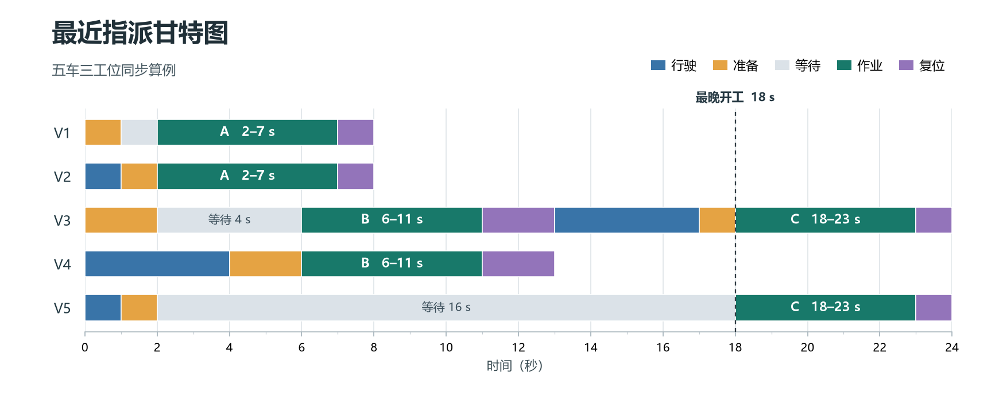
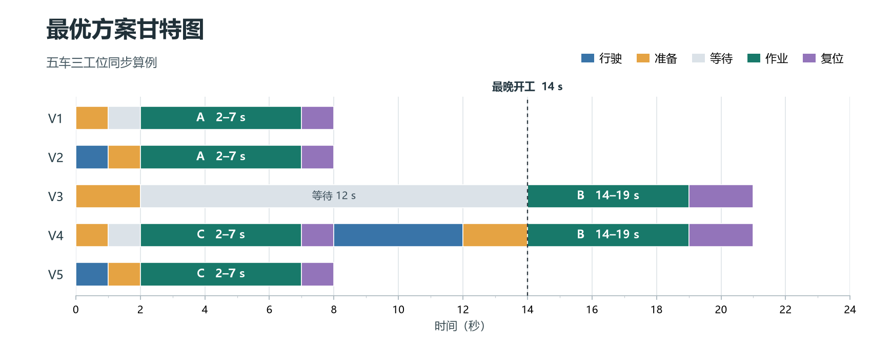

# 第二问（2）五车三工位同步算例

三项搬运任务同时发布，每项都需要两辆不同的车到场协同作业。以三项任务中**最晚的开始时刻**衡量方案。下表全部输入均为本算例设定，时间单位为秒。

| 工位 | A | B | C |
| --- | ---: | ---: | ---: |
| 直线通道上的位置 | 0 | 9 | 13 |
| 每车准备时间 | 1 | 2 | 1 |
| 双车共同作业时间 | 5 | 5 | 5 |
| 每车复位时间 | 1 | 2 | 1 |

V1 至 V5 的起点依次为 0、1、9、13、14。车速为每秒 1 个位置单位，任意两点间的行驶时间等于位置差的绝对值。每个工位容得下两辆车，通道允许自由通行。车辆到站后准备，先就绪者原地等待搭档，双方就绪后立即开始作业。每车在本站复位完毕后才可再次出发。

## 两种指派及其时间轴

**最近指派。** 按 A、B、C 的顺序编排任务。每次从十种车对中选两车新增行驶距离之和最小的一对，距离从各车已分配序列的末站计算，尚未分配者从起点计算。并列时取编号字典序最小的一对。该顺序只用于编排，互不依赖的车可在零时刻同时出发。A 选 V1、V2，B 选 V3、V4；给 C 配车时，V5 距 C 为 1，位于计划末站 B 的 V3、V4 距 C 均为 4，故取 V3、V5。

| 车辆 | 任务 | 出发 | 到站 | 准备完毕 | 等待搭档区间 | 共同作业区间 | 复位区间 |
| --- | --- | ---: | ---: | ---: | --- | --- | --- |
| V1 | A | 0 | 0 | 1 | 1–2 | 2–7 | 7–8 |
| V2 | A | 0 | 1 | 2 | 无 | 2–7 | 7–8 |
| V3 | B | 0 | 0 | 2 | 2–6 | 6–11 | 11–13 |
| V3 | C | 13 | 17 | 18 | 无 | 18–23 | 23–24 |
| V4 | B | 0 | 4 | 6 | 无 | 6–11 | 11–13 |
| V5 | C | 0 | 1 | 2 | 2–18 | 18–23 | 23–24 |

**优化指派。** 保留 V1、V2 服务 A。让 V4、V5 先服务 C，V4 完成复位后与 V3 会合服务 B。V3 在零时刻即可在 B 准备。两方案中，车辆完成最后一个复位区间后均空闲；出发与到站同刻表示该车起点恰在工位。

| 车辆 | 任务 | 出发 | 到站 | 准备完毕 | 等待搭档区间 | 共同作业区间 | 复位区间 |
| --- | --- | ---: | ---: | ---: | --- | --- | --- |
| V1 | A | 0 | 0 | 1 | 1–2 | 2–7 | 7–8 |
| V2 | A | 0 | 1 | 2 | 无 | 2–7 | 7–8 |
| V3 | B | 0 | 0 | 2 | 2–14 | 14–19 | 19–21 |
| V4 | C | 0 | 0 | 1 | 1–2 | 2–7 | 7–8 |
| V4 | B | 8 | 12 | 14 | 无 | 14–19 | 19–21 |
| V5 | C | 0 | 1 | 2 | 无 | 2–7 | 7–8 |

## 成绩与最优性

两图采用相同的 0–24 秒时间轴。竖虚线标出最后一个工位的开始时刻，作业条中的字母对应工位。





| 方案 | A 开始 | B 开始 | C 开始 | 最晚开始 | 总行驶时间（车秒） |
| --- | ---: | ---: | ---: | ---: | ---: |
| 最近指派 | 2 | 6 | 18 | 18 | 10 |
| 优化指派 | 2 | 14 | 2 | 14 | 6 |

最晚开始时刻提前 4 秒，改善比例为 4/18 = 22.22%。沿接续车辆的时间轴看，最近指派中 V3 在 B 等到第 6 秒才开始，至第 13 秒才能转场；优化指派中 V4 在 C 第 2 秒开始，第 8 秒即可转场。两个方向的转场都用 4 秒，抵达后的准备分别用 1 秒和 2 秒，最终得到 18 秒和 14 秒。优化方案接受了 V3 在 B 等待 12 秒，同时使 C 提前 16 秒开工。

**为何 14 秒已是下限。** 三项任务需要六个参与车次，五辆车中至少一辆须连续服务两个不同工位。即使把其他任务暂时移除，从五个起点到每个工位的第二短行驶时间，加上本站准备时间，仍给出该任务最早可能的开始时刻：A 为 2 秒，B 为 6 秒，C 为 2 秒。对复用车的任一相邻任务 i、j，第二项开始时刻至少等于第一项的最早开始时刻，加上共同作业 5 秒、i 的复位、两站转场和 j 的准备。

| 接续方向 | A→B | B→A | A→C | C→A | B→C | C→B |
| --- | ---: | ---: | ---: | ---: | ---: | ---: |
| 第二项开始时刻下界（s） | 19 | 23 | 22 | 22 | 18 | 14 |

六种方向的最小下界为 14 秒，优化指派恰好达到。另按三个任务的六种排列、每项十种车对回放了 6,000 个组合。排列决定共享车辆先服务哪项，独立任务可以同时开始。每个可行时序均可按任务开始先后排列，同刻开始的任务使用不同车辆，故这一回放覆盖所有可行的车组与接续顺序。最小成绩同为 14 秒。

## 对原题的适用范围

原题可沿用双车就绪后取较晚时刻、作业后复位才能复用、按各任务开始时刻的最大值计分这三条规则。六个参与车次需要至少一次复用的计数论证同样成立；可用原题自己的行驶与准备时间重新推导下界。比较最近指派时，应预先明确任务顺序、距离口径和并列规则，并让两种方案使用相同的可行性约束。

本例采用一维固定工位与给定的准备时长。原题要由可观测站位、可行行驶路径和云台转角决定对应时长。这里的车组、逐车时间、14 秒下界及 22.22% 改善比例均仅适用于本例。

完整数值表见同目录《五车三工位时间轴.csv》。在第二问目录运行以下命令即可从逐车就绪时刻重算两方案成绩。

```shell
python 代码/compare_ready_times.py 文档/五车三工位时间轴.csv --baseline NEAR --candidate OPT --tasks A B C
```
