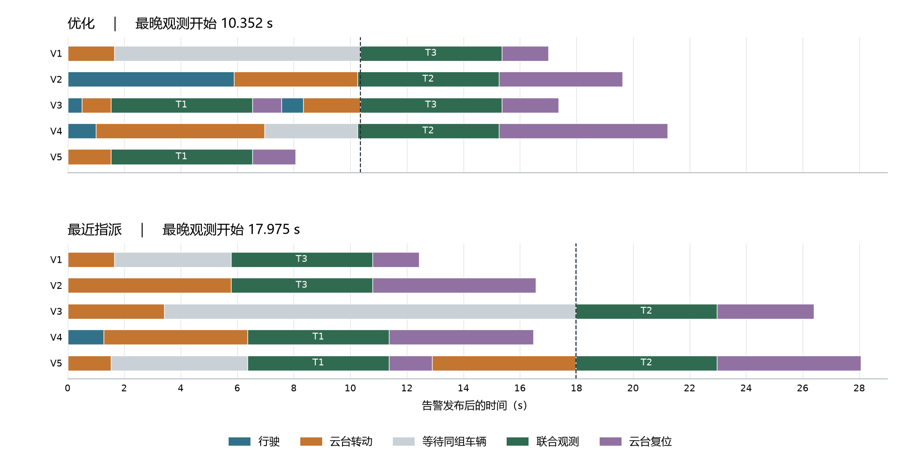

# 第二问第（2）题　并发告警的逐车时间轴

联合优化将最晚观测开始时刻从最近指派的 **17.975327433 s** 提前至 **10.352118549 s**，缩短 **7.623209 s（42.41%）**。可行方案距离连续模型的全局下确界小于 **50 ns**。按题面禁止视线接触建筑的规则，**下确界可以任意逼近，但没有可行方案能达到它**。

| 告警 | 优化车组 | 优化开始（s） | 最近指派车组 | 最近指派开始（s） |
| --- | --- | ---: | --- | ---: |
| T1 | V3、V5 | 1.532033 | V4、V5 | 6.368152 |
| T2 | V2、V4 | 10.255414 | V3、V5 | **17.975327** |
| T3 | V1、V3 | **10.352119** | V1、V2 | 5.777589 |

沿用第（1）问的误差模型，设两车方位测量误差相互独立，标准差均为 1°。按实际调度站位计算交会角 γ 和局部水平定位均方根误差 E。

| 告警 | 联合调度 γ（°） | 联合调度 E（m） | 最近指派 γ（°） | 最近指派 E（m） |
| :--- | ---: | ---: | ---: | ---: |
| T1 | 19.80 | 4.27 | 173.45 | 6.47 |
| T2 | 48.00 | 2.85 | 49.84 | 1.05 |
| T3 | 59.35 | 1.98 | 174.23 | 9.21 |

联合调度使 T1、T3 的定位误差减小，但 T2 提前开始观测的同时，误差由 1.05 m 增至 2.85 m。题目未设最低定位精度，表中误差用于比较两套方案的观测几何。

联合调度中，V3 观测 T3 时，相机至目标的视线段与建筑表面的最小三维距离约为 25 nm（0.000000025 m）。按标称坐标，视线与建筑仍有间隙，满足题面禁止接触的通视条件。但这一间隙极小，站位或建筑尺寸的微小偏差就可能造成遮挡。

## 时间与约束

所有时刻以三项告警发布为零点。对于长度为 $L$ 的路线，若车辆在 $d$ 时刻出发，则到站时刻为 $a=d+L/3$。到站即开始转动。令 $\alpha$ 为从正东起的最短有符号方位转角，$\beta$ 为俯仰角，双轴同时转动用时为 $g=\max(|\alpha|,|\beta|)/30$，其中角度以度计。两车就绪时刻为各自的 $a+g$。联合观测开始于两者较大值 $S_j$，结束于 $S_j+5$。两车随即分别复位，用时各自的 $g$。复用车从 $S_j+5+g$ 立即驶往下一站；原地站址的行驶时长为零。目标函数为 $\min\max_j S_j$。

两套方案都检查了车身圆盘净空、场地边界、视线与建筑棱柱不得接触、俯仰范围、两路方位不共线和同步观测时序。题目第（2）项没有给定最低交会角或精度阈值。两套方案采用相同的角度和几何条件。

## 优化方案

| 车辆 | 告警 | 站址（m） | 出发 | 到站／转动开始 | 指向完成 | 观测开始 | 观测结束／复位开始 | 复位完成 |
| --- | --- | --- | ---: | ---: | ---: | ---: | ---: | ---: |
| V1 | T3 | (15, 14) | 0.000 | 0.000 | 1.659 | 10.352 | 15.352 | 17.011 |
| V2 | T2 | (72.5, 1.5) | 0.000 | 5.893 | 10.255 | 10.255 | 15.255 | 19.618 |
| V3 | T1 | (15.04240371255, 87.07805593987) | 0.000 | 0.500 | 1.532 | 1.532 | 6.532 | 7.564 |
| V3 | T3 | (16.76559943139, 88.65893235955) | **7.564** | 8.344 | 10.352 | 10.352 | 15.352 | 17.361 |
| V4 | T2 | (88, 71) | 0.000 | 1.000 | 6.963 | 10.255 | 15.255 | 21.218 |
| V5 | T1 | (50, 93) | 0.000 | 0.000 | 1.532 | 1.532 | 6.532 | 8.064 |

每段路线为前一位置至表中站址的直线。指向完成早于观测开始时，车辆保持指向等待同组车辆。各车最后一次复位后在本站待命。所有时间列单位为 s。

求解先在 0.5 m 站址网格上加入车辆起点和绕障节点。对一辆复用车、两个有先后关系的告警和另外四辆车的分工进行联合搜索，按该组合的同步时序计分。在最佳网格方案上细化 V3 的两处连续站址，并对细化后路径和视线重新核验。

## 最近指派基准

1. 按题面编号 T1、T2、T3 逐项规划。每次以车辆的计划末站为当前位置，尚未指派的车用初始位置。按到当前目标水平投影的欧氏距离给五辆车排序，取最近的两辆，平局按车号处理。
2. 按所选两车的排序，分别选取共用候选站集中最短可行行驶路径对应的站址。第二辆还必须满足交会非共线和两车车心间距至少 3 m。路线在由站址、出发点和建筑外扩角点组成的可见图上计算。站址与出发点一致时取零行程。平局按站址坐标顺序处理。
3. 指派编号决定每车的服务顺序。未被占用的车辆从零时刻出发，已有任务的车辆在复位结束后立即出发。实际观测开始时刻由两车就绪时刻决定。因此 T3 可先于 T1 实际开始。

| 车辆 | 告警 | 站址（m） | 出发 | 到站／转动开始 | 指向完成 | 观测开始 | 观测结束／复位开始 | 复位完成 |
| --- | --- | --- | ---: | ---: | ---: | ---: | ---: | ---: |
| V1 | T3 | (15, 14) | 0.000 | 0.000 | 1.659 | 5.778 | 10.778 | 12.436 |
| V2 | T3 | (88, 10) | 0.000 | 0.000 | 5.778 | 5.778 | 10.778 | 16.555 |
| V3 | T2 | (14, 86) | 0.000 | 0.000 | 3.414 | 17.975 | 22.975 | 26.389 |
| V4 | T1 | (91.5, 66.5) | 0.000 | 1.269 | 6.368 | 6.368 | 11.368 | 16.467 |
| V5 | T1 | (50, 93) | 0.000 | 0.000 | 1.532 | 6.368 | 11.368 | 12.900 |
| V5 | T2 | (50, 93) | **12.900** | 12.900 | 17.975 | 17.975 | 22.975 | 28.050 |

基准方案中仅 V4 实际行驶，沿直线驶向 T1 站址。V5 复位后在同一站址切换至 T2，12.900 s 的出发与到站为同一时刻。

## 差异来源

基准中 V4 离 T1 水平投影最近，但原地俯仰角超限，须先行驶 3.808 m，再花 5.099 s 指向。V5 在 1.532 s 已就绪，仍须等到 6.368 s 才能和 V4 观测。V5 观测并复位后，原地对准 T2 还需 5.075 s，其中方位转角约 $152.25^\circ$。V3 已在 3.414 s 对准 T2，须等 V5 至 17.975 s。

优化让 V3 与 V5 同时在 1.532 s 就绪。V3 完成 T1 后只行驶 2.338 m，随后用 2.008 s 指向 T3。以两套方案各自决定最晚开始的那条复用链比较，首次观测提前 4.836 s，第一次复位缩短 0.500 s，第二次指向缩短 3.067 s，抵消了多出的 0.779 s 行驶。两条复用链的观测时长都是 5 s。T3 比基准晚 4.575 s，T2 提前 7.720 s，最终瓶颈由 T2 转到 T3。

## 连续下确界及其可达性

六个车位至少需要一辆车复用。枚举五辆车与两个不同告警的六种有序组合。对复用车，记起点为 $o$，前两站为 $p,q$，目标为 $i,j$，并用 $H_{-k,i}$ 表示除该复用车外最早可到站并完成 T$i$ 指向的时刻下界。无论其他任务如何安排，第二次观测开始都满足

$$
S_j\ \ge\ \max\!\left(H_{-k,i},\ \|p-o\|/3+g_i(p)\right)
+5+g_i(p)+\|q-p\|/3+g_j(q).
$$

按上式对连续站址做分支定界。将行驶放松为直线，分别取矩形内的行驶和转动下界，排除超限区域及完全落在建筑阴影内的区域。对 10.352124 s 的阈值检查了 126,010 对矩形。所有达到该阈值以内的方案都须由 V3 先服务 T1、再服务 T3，且

$$
p\in P=[14.94,15.15]\times[86.97,87.18],\qquad
q\in Q=[16.66,16.87]\times[88.55,88.77].
$$

对这条复用链，V5 在原地为 T1 指向的 1.532032714 s 是其他车辆中最早的就绪时间。V1、V2、V4 的同一时间阈值均被二维分支定界排除。V5 若要获得更快时刻，移动范围至多为 $3\times1.532032714$ m。在此范围内，两轴指向时间随位置变化的斜率均小于 $1/3$ s/m，移动耗时超过它能省下的指向时间。记该精确就绪时刻为 $H$。

在 $Q$ 内，B3 与 B5 的两条阴影边界共同约束 T3 的站位。记其交点为 $q_b=(16.765599373356,88.658932259545)$ m。它位于 T3 水平投影和 B3 东北角的连线上，纵坐标为 B5 北侧屋顶边缘在相机平面的投影。令 $k=(x_{T3}-24)/(76-y_{T3})>0$。题面要求 $q$ 严格位于两条边界外侧，故

$$
q_y-q_{b,y}>0,\qquad q_x-q_{b,x}+k(q_y-q_{b,y})>0.
$$

固定任意 $p\in P$，记第二段行驶及指向用时为 $G_p(q)=\|q-p\|/3+g_3(q)$。在整个 $Q$，方位轴决定 T3 指向用时。由距离和方位角的偏导可核验 $\partial_xG_p>0$，且 $\partial_yG_p-k\partial_xG_p>0.00834$ s/m。沿 $q_b$ 到任何可行 $q$ 的线段积分，得到 $G_p(q)>G_p(q_b)$。两条边界均禁止接触，故交点仅用于计算极限。将 $q_b$ 向北移动任意足够小的正距离即可恢复两条视线的净空。

将 $H_{-k,i}=H$、$q=q_b$ 代入前面的复用时间表达式，得到关于 $p$ 的连续函数。它在闭矩形 $P$ 上取到最小值，记作 $M_{\inf}$。V3 到 $P$ 以及由 $P$ 到 $Q$ 均可沿直线行驶，V5、V1 原地就绪，其余车辆服务 T2，10.255414 s 即开始。因此，从最小值对应的 $p$ 出发，采用上述向北微移的 T3 站位便可形成一族成绩趋向 $M_{\inf}$ 的可行调度。另一方面，任何位于 10.352124 s 以内的可行方案都满足 $S_3>M_{\inf}$，更慢的调度也无法达到该值。这就说明原模型只有下确界。

对 $P$ 内的第一站再做二维定界，结合距离的切线下界与俯仰时间的泰勒余项界，共检查 127,841 个矩形，得到 $M_{\inf}\ge10.352118500$ s。贴边计算取 $p\approx(15.042403788427,87.078055861978)$ m 时得到 10.352118509755 s，因此 $M_{\inf}\in[10.352118500,10.352118510]$ s。贴边方案仅用于界定下确界，实际复核使用表中满足净空的坐标。

## 可行性复核

从导出的线段和站址独立重算，优化及基准路径的最小车心至建筑距离均为 7.280 m，两方案行驶和等待期间的最小双车间距分别为 33.517 m、36.674 m。各目标 T1、T2、T3 的交会角分别为优化方案的 $19.795^\circ,47.998^\circ,59.352^\circ$ 和基准方案的 $173.452^\circ,49.842^\circ,174.229^\circ$。优化方案 V3 的 T3 视线最小三维净空约为 $2.50\times10^{-8}$ m。结果按题设标称参数复核，重算使用 CSV 的完整站址坐标。

运行入口为 `第二问/代码/q2_schedule.py`（求解与导出）、`q2_schedule_verify.py`（独立复核与绘图）及 `q2_schedule_limit.py`（连续定界与边界可达性）。逐车路径、角度和九位小数时刻见[时间轴 CSV](第二问第（2）题逐车时间轴.csv)。
