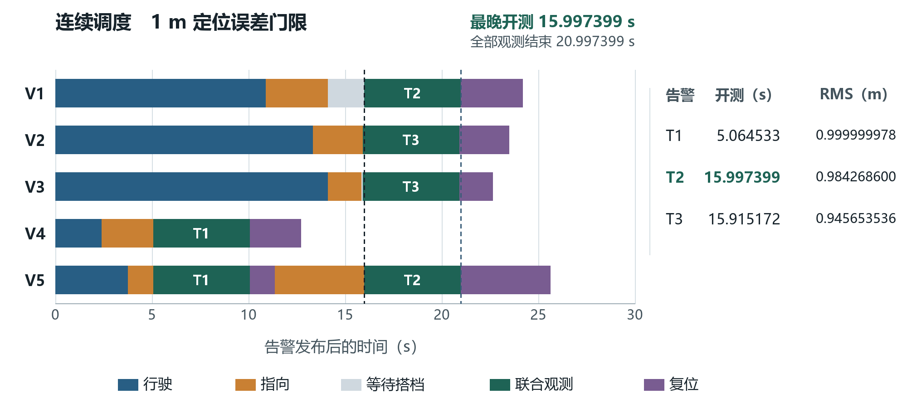

# 第二问第（2）项的误差门限与观测排程

## 连续分支定界

在仓库根目录输入误差门限，单位为米。程序输出最晚开测、全部观测结束时刻、各告警的水平定位 RMS、全局时间下界和逐车时间轴。需要 Python、NumPy 和 SciPy。

```powershell
py -3.14 "第二问/代码/q2_schedule_continuous.py" --error 1
```

令每个告警的两站对目标的水平距离为 $r_1,r_2$，交会角为 $\gamma$，两车的方位误差标准差为 $\sigma=\pi/180$。共同门限 $\varepsilon$ 要求每个告警满足

$$
\frac{\sigma\sqrt{r_1^2+r_2^2}}{|\sin\gamma|}\le\varepsilon .
$$

程序将该约束用于两步。先从网格可行方案或搜索所得的车组与复用顺序出发，联合微调六个连续站址，重新计算两车的实际就绪时刻，并复核路线、视线、间距和 RMS。计算全局时间下界时，用一组覆盖连续场地的矩形估计两站的最小距离和交会角正弦的最大值，只在矩形站对有可能达标时保留它。由这些矩形站对给双车就绪时刻定界，在同一分支定界搜索中剪枝。矩形覆盖只用于下界，输出站址可以取矩形内任意坐标。

### 1 m 实跑结果



| 方案 | 最晚开测（s） | 全部观测结束（s） |
| --- | ---: | ---: |
| 连续分支定界，预算内可行方案 | **15.997399283** | **20.997399283** |
| 已核对的 3 m 网格最优记录 | 16.040435631 | 21.040435631 |
| 同次运行的 15 s 网格初始方案 | 16.044067819 | 21.044067819 |

连续方案比网格最优记录早 **43.036 ms**。本次达到 100,000 节点预算，全局下界为 **14.551443120 s**，距可行时间 **1.445956 s**。因此 15.997399283 s 是已核验的连续可行时间。可用 `--nodes` 调整节点预算。

| 告警 | 车组 | 开测（s） | 求解 RMS（m） | 独立方位微扰复算（m） |
| --- | --- | ---: | ---: | ---: |
| T1 | V4、V5 | 5.064533128 | 0.999999977877 | 0.999999976545 |
| T2 | V1、V5 | 15.997399283 | 0.984268600021 | 0.984268599927 |
| T3 | V2、V3 | 15.915171703 | 0.945653535694 | 0.945653534738 |

从导出的完整坐标独立用雅可比协方差重算，三项与解析式相符。方位微扰法的最大差约 $1.33\times10^{-9}$ m，三项均达标。无门限重跑的最晚开测为 **10.352118549 s**，逐车时间轴与接入门限前逐字节一致。无门限方案的 T1、T2、T3 RMS 分别为 4.269894、2.866566、1.982071 m。[1 m 逐车时间轴](第二问第（2）题连续分支定界_1m时间轴.csv)

## 网格版查询

从仓库根目录运行以下命令，然后输入每个目标的最大允许水平定位均方根误差（米）。每次输入都会按原题场地、五辆车和观测规则重新选站与排程。直接回车退出。需要 Python、NumPy 和 SciPy。

```powershell
py -3.14 "第二问/代码/q2_error_limit.py"
```

可以一次试算多个门限，也可以给一个门限导出逐车时间轴。

```powershell
py -3.14 "第二问/代码/q2_error_limit.py" 0.5 1 2
py -3.14 "第二问/代码/q2_error_limit.py" 1 --csv "1m时间轴.csv"
```

## 原题求解模式

程序在 3 m 方格上添加车辆初始位置、绕障拐点及靠近俯仰边界的圆环采样点。对每个告警，它筛选可停靠、通视且俯仰角合规的站位。对一对站位，分别略微增减两车的方位读数，逐次重求交点。用四次交会计算各方位误差造成的局部位置变化，再按两车测角误差独立、各为 1° 标准差估计位置 RMS。门限适用于每个告警的 RMS。

搜索比较两车分工、目标先后和离散站对。按现有绕障路网规划各段最短路径，用原题速度、云台规则和 5 s 联合观测重放，并检查整段路线的车间距。目标仍为三个告警中最晚的观测开始时刻。CSV 中包含路点及每段出发、到站、指向完成、观测起止、复位完成的时刻。

默认每个门限搜索 15 s。显示“离散模型最优”表示已穷尽这些候选站和车组，在固定路网、车辆尽早行驶与开测的规则下得到最小值。届时连续场地仍可能有更快的站位。显示“时限内找到的最快可行解”时，程序已经核验返回的排程，最优性尚待证明。可用 `--seconds 0` 枚举至结束，或用 `--grid 2` 调整网格间距。网格间距支持 2–20 m，更密的网格会增加站对计算量及内存占用。

### 1 m 门限的穷尽核对

在默认 3 m 候选站位集和固定绕障路网内，最晚开测的最小值为 **16.040435631 s**，比此前限时搜索的 16.044067819 s 早约 **3.632 ms**。全部联合观测在 **21.040435631 s** 结束。[五车甘特图](../图片/原题_1m误差门限_五车甘特图.png)

| 目标 | 车组 | 开测（s） | 局部水平定位 RMS（m） |
| --- | --- | ---: | ---: |
| T1 | V4、V5 | 5.064533 | 0.988784 |
| T2 | V1、V5 | 16.040436 | 0.992138 |
| T3 | V2、V3 | 13.796208 | 0.981102 |

把三个告警的六种先后顺序与每项十种车组组合，得到 6,000 种离散指派。对每种指派，遍历精度达标的站对，取各任务独立从起点就绪的最早时刻和复用车辆连续两次服务链的最早时刻中的最大值，作为该指派的下界。计算服务链时，允许搭档忽略自身的其他任务，以保留下界性质。所有指派的下界均不低于上述方案的数值重放时刻（比较容差 1 ns）。重放的车心到建筑最小距离为 1.501 m，视线到建筑最小距离约为 0.980 m，最小车间距为 18.000 m。结论限定于这个离散模型。

## 室内实验条件

使用 `py -3.14 "第二问/代码/q2_error_limit.py" --floor 1` 可复现独立的室内地面测距实验。这一模式只需 Python 和 NumPy。

四辆车分别在 y = 0、4、9、13 m 的独立直轨上运行，起始横坐标分别为 1、15、4、17 m。每辆车可停在本轨的 x = 2、9、16 m 三站之一，速度为 1 m/s。三个地面标记同时交付测量。每项需两台不同车，各车到站后准备 1 s，两车就绪后同时采集 4 s，采集结束即可前往下一站。独立车组可以同时工作。

模拟器为每次测距加入独立高斯读数误差，标准差设为 0.20 m 加真距离的 3.5%，负距离截为零。每个地面标记所在的 6 m × 6 m 方格已知。对两车的一次读数，程序在该方格的 0.1 m 网格上逐点比较两项测距残差的平方和，取残差最小的位置。用 256 次估计位置与真值的距离计算均方根误差（RMS）。种子固定为 20261121，同一会话复用测距试验，便于比较门限。此门限约束的是样本 RMS，单次读数的误差仍可超过门限。

若两项测距容许镜像解，程序对残差平方和相差不超过 10⁻¹² m² 的并列最优位置等权计入平方误差，避免因网格排列顺序而偏向其中一侧。

每个地面点有 6 种车组，每组有 9 种停站组合。程序按门限筛选各自的 54 个站对，遍历达标组合和三项任务的全部六种先后顺序。固定每辆车的前后任务和停站后，尽早行驶、准备和开始测量即可取得这套安排的最早时刻。搜索只跳过已经无法改善当前成绩的分支。首要目标是使最晚开始时间最小，同一时间下优先选三个测点中最大 RMS 更小的方案。

| 共同 RMS 门限 | 最短的最晚开始时间 | 全部完成时间 |
| ---: | ---: | ---: |
| 1.0 m | 7 s | 11 s |
| 0.8 m | 11 s | 15 s |
| 0.5 m | 无达标排程 | — |

这些最优值对应上述室内轨道、离散停站、模拟读数和作业时长。每项采集时间相同，因此全部完成时间等于最晚开始时间加 4 s。

## 旧论文时间轴查询

如需复现原论文时间轴的筛选结果，使用 `py -3.14 "第二问/代码/q2_error_limit.py" --archive 4.27`。旧模式需要 SciPy。`--scores`、`--reference` 也会进入旧模式。以下说明仅适用于该模式。

门限约束的是每个目标的局部水平定位均方根误差。沿用两车方位误差独立且标准差均为 1° 的模型，令 σ = π/180，E = σ√(r₁² + r₂²)/|sin γ|。同一套方案的三个目标均满足 E ≤ 门限才入选，比较量为该方案三次观测开始时刻的最大值。计算使用原始精度，显示时才取整。

程序读取并复核项目已有的两套完整时间轴。输出的候选集最小值是这个有限集合的精确筛选结果。连续场地允许选择其他站位，已知可行方案给出其时间上界。若当前集合没有达标方案，程序仍会计算时间下界。仅凭空候选集不能断定原问题无解。

例如，门限为 4.27 m 时，时间下界为 10.352118500 s，已复核方案达到 10.352118549 s。门限为 0.50 m 时，时间下界为 17.963650911 s，仓库已有的两套时间轴均不达标。可选参数 `--reference` 单列桌面对照稿在 0.50、0.75、1.00 m 三个门限下报告的取整时间，这些汇总数据不参与已核验时间轴的排名。

### 时间轴查询的下界

仰角上限给出两站各自的最小水平距离 r₀ = (H − 2)/tan 80°，因此 E ≥ σ√2 r₀。三个目标中 T3 的理论下界最高，约为 0.230667817 m。低于该值的共同门限必然不可行。

对于通过此必要条件的门限 ε，同一站对中每个站到目标的水平距离至多为 R = √((ε/σ)² − r₀²)。可以把两个站分别放宽到对应的半径 R 圆盘中，以点到圆盘、圆盘到圆盘的最短距离估计行驶时间，并以圆盘最外缘对应的俯仰角估计转动时间。放宽后的每一段都给出耗时下界。程序枚举三个任务的六种先后顺序及各任务的十种车辆组合，保留同步、5 s 观测与复位约束，求这个放宽问题的最小时间。最后与[原题无门限下界](第二问第（2）题结论.md)取较大值。

### 追加已计算的方案

使用 `--scores 文件.csv` 可加入同一题设下自行核验的其他方案。每行必须来自一套完整可行方案，时间单位为 s，误差单位为 m。以下是必需的列名。

```csv
方案,T1误差_m,T2误差_m,T3误差_m,T1开始_s,T2开始_s,T3开始_s
```

程序会重新对全部候选排名。外部成绩表只提供汇总指标，其路径、时序及测量模型须由数据提供者核验。
